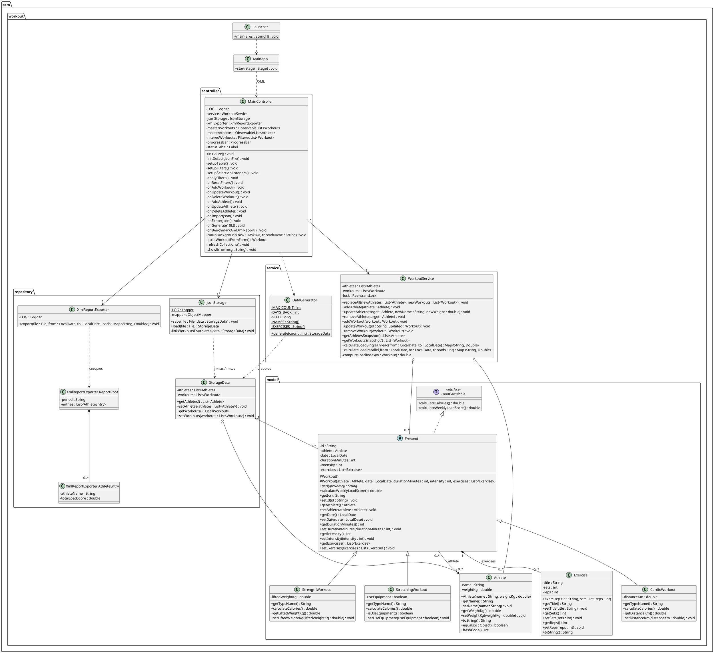
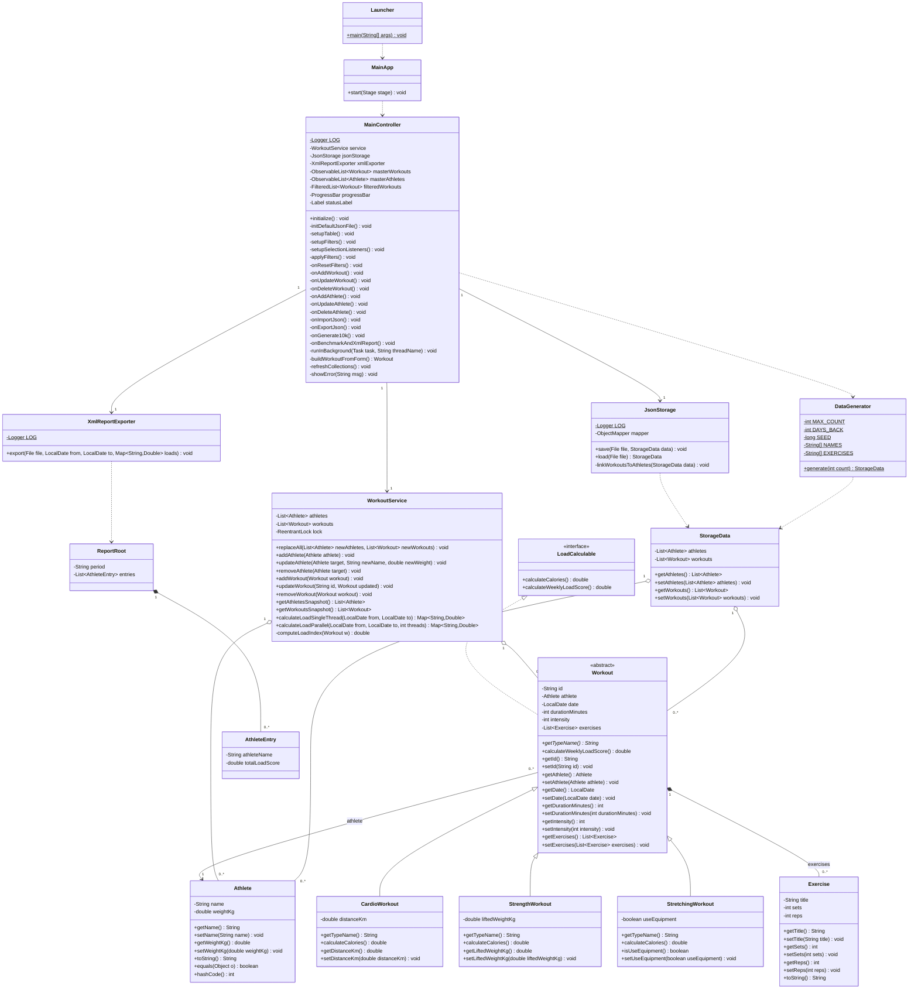
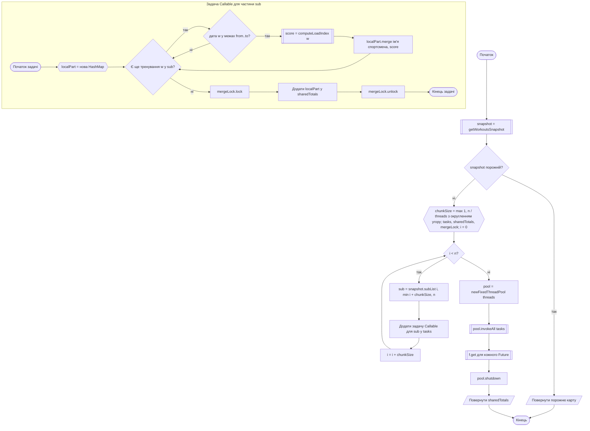
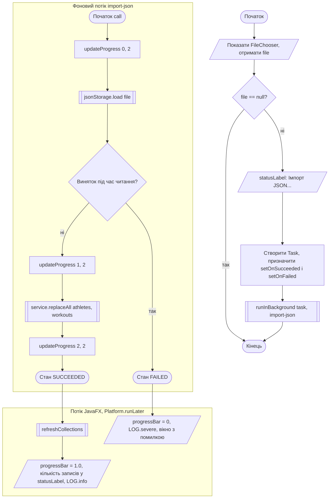

# DESIGN – Менеджер спортивних тренувань

## 1. Специфікація

**Користувач:** тренер або спортсмен, який веде облік тренувань.

**Дані:**
- спортсмен (`Athlete`) – ім'я, вага 25–250 кг; ім'я унікальне без урахування регістру;
- вправа (`Exercise`) – назва, кількість підходів і повторень (більше 0);
- тренування (`Workout`) – ідентифікатор UUID, спортсмен, дата, тривалість 1–600 хв, інтенсивність 1–10, список вправ;
  три типи: `CardioWorkout` (дистанція 0–300 км), `StrengthWorkout` (тоннаж 0–100 000 кг), `StretchingWorkout` (ознака інвентарю).

**Дії користувача:**
- додати, редагувати, видалити спортсмена і тренування (CRUD);
- шукати тренування за ім'ям спортсмена, фільтрувати за типом і періодом дат, сортувати за будь-яким стовпцем таблиці (`FilteredList` + `SortedList`);
- імпортувати й експортувати дані в JSON (Jackson) у фоновому потоці;
- згенерувати 10 000 тестових записів у фоновому потоці;
- розрахувати тижневе навантаження спортсменів за період в одному потоці (T1) і на пулі потоків (Tn), отримати прискорення S = T1/Tn і XML-звіт `weekly_load_report.xml` (JAXB).

**Архітектура MVC:**

| Шар | Класи | Роль |
|---|---|---|
| Model | `LoadCalculable`, `Athlete`, `Exercise`, `Workout`, `CardioWorkout`, `StrengthWorkout`, `StretchingWorkout` | доменні дані, перевірка значень у сеттерах, поліморфний розрахунок калорій |
| Service | `WorkoutService`, `DataGenerator` | CRUD у пам'яті під `ReentrantLock`, розрахунок навантаження в `ExecutorService`, тестові дані |
| Repository | `JsonStorage`, `StorageData`, `XmlReportExporter` | JSON-файл даних, XML-звіт |
| Controller | `MainController` | обробка подій, фонові `Task`, оновлення інтерфейсу |
| View | `main-view.fxml`, `MainApp`, `Launcher` | вікно з таблицею, формами і `ProgressBar` |

**ООП:** абстракція – абстрактний клас `Workout` і інтерфейс `LoadCalculable`; наслідування – три типи тренувань від `Workout`;
поліморфізм – `calculateCalories()` і `getTypeName()` викликаються через змінну типу `Workout` у таблиці та в `WorkoutService.computeLoadIndex()`;
інкапсуляція – приватні поля, перевірка в сеттерах з `IllegalArgumentException`.

**Структура JSON** (`trainings.json`):

```json
{
  "athletes": [ { "name": "Анна Мельник", "weightKg": 64.0 } ],
  "workouts": [
    {
      "workoutType": "CARDIO",
      "id": "6f1c…",
      "athlete": { "name": "Анна Мельник", "weightKg": 64.0 },
      "date": "2026-11-10",
      "durationMinutes": 45,
      "intensity": 7,
      "exercises": [ { "title": "Інтервальний біг", "sets": 3, "reps": 12 } ],
      "distanceKm": 8.0
    }
  ]
}
```

Поле `workoutType` (`CARDIO`, `STRENGTH`, `STRETCHING`) визначає клас під час читання (`@JsonTypeInfo`, `@JsonSubTypes`).

Кожне тренування зберігає в JSON власну копію спортсмена. Після читання `JsonStorage.linkWorkoutsToAthletes()` замінює ці копії об'єктами зі списку `athletes` (порівняння імені без урахування регістру), а відсутніх спортсменів додає до списку. Тому перейменування і видалення спортсмена після перезапуску застосунку змінює всі його тренування.

**Структура XML** (`weekly_load_report.xml`):

```xml
<weeklyLoadReport>
    <period>2026-09-15 - 2026-11-14</period>
    <athleteLoad>
        <athleteName>Ірина Кравченко</athleteName>
        <totalLoadScore>877.45</totalLoadScore>
    </athleteLoad>
</weeklyLoadReport>
```

**Багатопоточність:**
- фонові задачі `javafx.concurrent.Task` у `MainController`: імпорт JSON, експорт JSON, генерація 10 000 записів, розрахунок T1/Tn із записом XML;
- `runInBackground()` запускає задачу в потоці-демоні та прив'язує `ProgressBar` до `task.progressProperty()`;
- спільні дані – списки `athletes` і `workouts` у `WorkoutService`, їх захищає `ReentrantLock lock`; у `calculateLoadParallel()` спільна карта `sharedTotals` захищена окремим `ReentrantLock mergeLock`;
- інтерфейс оновлюється лише в потоці JavaFX: обробники `setOnSucceeded` / `setOnFailed` і `Platform.runLater()`;
- помилки фонових задач перехоплює `setOnFailed`: запис `LOG.severe` у журнал і вікно з повідомленням.

## 2. UML-діаграма класів

### PlantUML



### Mermaid



`ReportRoot` і `AthleteEntry` – вкладені статичні класи `XmlReportExporter`. Конструктори без параметрів, які потрібні Jackson і JAXB, на діаграмі не показано. У `MainController` з полів `@FXML` показано лише `progressBar` і `statusLabel`, решта – поля форми і стовпці таблиці.

Де відрендерити: planttext.com або plantuml.com (PlantUML), mermaid.live (Mermaid), draw.io: Arrange → Insert → Advanced → PlantUML / Mermaid.

## 3. Блок-схеми (ДСТУ ISO 5807:2016)

Позначення в Mermaid: `([ ])` – термінатор, `[ ]` – процес, `{ }` – рішення, `[/ /]` – введення/виведення даних, `[[ ]]` – визначений процес (виклик методу), `{{ }}` – підготовка.
Mermaid не має символу межі циклу і не контролює перетини ліній. Фінальний рисунок для записки краще перемалювати в draw.io (бібліотека «Блок-схема»): цикли позначити межами циклу «Цикл по частинах» і «Цикл по тренуваннях», лінії повернення вгору – зі стрілками.

### 3.1 `WorkoutService.calculateLoadParallel(from, to, threads)`

Алгоритм:
1. Отримати копію списку тренувань `snapshot` через `getWorkoutsSnapshot()` (під блокуванням `lock`).
2. Якщо список порожній – повернути порожню карту.
3. Обчислити розмір частини `chunkSize = max(1, ⌈n / threads⌉)`, створити список задач `tasks`, спільну карту `sharedTotals` і блокування `mergeLock`.
4. Для кожної частини `snapshot.subList(i, min(i + chunkSize, n))` додати в `tasks` задачу `Callable`. Задача рахує власну карту `localPart`: для кожного тренування в межах періоду `[from; to]` додає до суми спортсмена значення `computeLoadIndex(w)`. Потім задача бере `mergeLock`, додає `localPart` у `sharedTotals` і знімає блокування в `finally`.
5. Створити пул `Executors.newFixedThreadPool(threads)`, запустити всі задачі `invokeAll(tasks)`.
6. Для кожного `Future` викликати `get()`: так виняток із задачі потрапляє у викликача (`ExecutionException`).
7. У `finally` закрити пул `pool.shutdown()`.
8. Повернути `sharedTotals`.



### 3.2 `MainController.onImportJson()`

Алгоритм (потік JavaFX і фоновий потік):
1. Показати `FileChooser` з фільтром `*.json`.
2. Якщо файл не обрано – вийти.
3. Вивести в рядок стану «Імпорт JSON...».
4. Створити `Task<StorageData>`, призначити обробники `setOnSucceeded` і `setOnFailed`.
5. Викликати `runInBackground(task, "import-json")`: `ProgressBar` прив'язується до прогресу задачі, задача стартує в потоці-демоні.
6. У фоновому потоці: `updateProgress(0, 2)` → `jsonStorage.load(file)` (перевірка порожнього файлу, синтаксису і структури) → `updateProgress(1, 2)` → `service.replaceAll(...)` під блокуванням `lock` → `updateProgress(2, 2)`.
7. Успіх: у потоці JavaFX через `Platform.runLater()` оновити колекції таблиці, встановити прогрес 1.0, вивести кількість записів, записати `LOG.info`.
8. Помилка: у потоці JavaFX через `Platform.runLater()` встановити прогрес 0, записати `LOG.severe`, показати вікно з помилкою. Дані в пам'яті не змінюються, бо `replaceAll` не виконувався.


